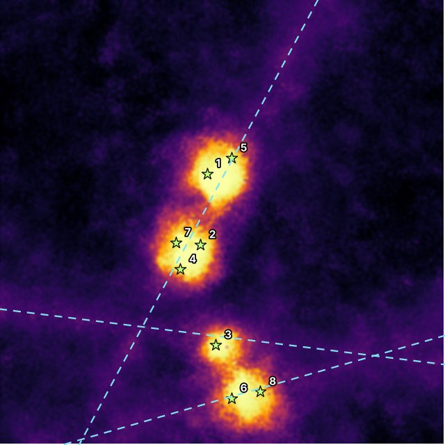

# GeoOre

**Geospatial ore-field identification and ore grade classification.**
A software-only mineral exploration tool: open satellite data, elevation models and geological maps
go in; a prospectivity heatmap, ranked sampling targets and ore grade predictions come out.

Project page: `https://<your-username>.github.io/GeoOre/`



## Features

- **Field identification**: iron-oxide (B4/B2) and clay-alteration (B11/B12) indices from Sentinel-2 / Landsat,
  combined with slope, relief and fault proximity to score every map cell.
- **Ore quality classifier**: XGBoost predicts high / medium / low grade from assay features;
  SHAP shows which elements drive each prediction.
- **Interactive map**: Folium (Leaflet) heatmap, confidence layer, faults, samples and a clickable explanation per cell.
- **GIS export**: GeoTIFF, GeoJSON and shapefiles for QGIS or ArcGIS.

## Quick start

```bash
pip install -r requirements.txt
python scripts/run_pipeline.py     # writes outputs/ (rasters, vectors, map.html, model, summary.json)
streamlit run app.py               # interactive app
pytest                             # 13 tests
```

## Real satellite data (Google Earth Engine)

```bash
pip install earthengine-api
earthengine authenticate
```

In the app sidebar choose **Google Earth Engine**, enter a bounding box and your Cloud project ID.
GeoOre downloads a cloud-masked Sentinel-2 median composite plus SRTM elevation for that area.
Upload your own assay CSV (`x, y, grade, Cu_ppm, Au_ppb, Fe_pct, S_pct, As_ppm, Zn_ppm, Pb_ppm, Mo_ppm`,
coordinates in the raster CRS) and a fault-line GeoJSON from your geological survey to complete the analysis.

## How it works

1. **Evidence layers**: spectral ratios, NDVI (to discount vegetated ground), slope/relief, distance to faults.
2. **Knowledge-driven score**: weighted fuzzy overlay; weights are adjustable.
3. **Data-driven score**: bootstrapped random forests trained on sample locations (mineralised vs. barren).
4. **Blend and confidence**: confidence is high where the forests agree with each other and with the overlay.
5. **Targets**: separated local maxima, each with a plain-language explanation.

## Results on the demo area

The offline demo area contains hidden ore bodies so the method can be validated.

| Metric | Value |
|---|---|
| Prospectivity ROC-AUC (3 random areas) | 0.998 / 0.999 / 0.998 |
| Grade classifier test accuracy | 98.2% |
| 5-fold CV macro F1 | 0.952 ± 0.019 |

Real ground is noisier than the demo area; use results to prioritise sampling, not replace it.

## Project layout

```
geoore/
  synthetic.py      demo study area (bands, DEM, faults, assays)
  indices.py        mineral indices
  terrain.py        slope, relief, fault distance
  prospectivity.py  scoring, confidence, targets, explanations
  grade_model.py    XGBoost grade classifier + SHAP
  export.py         GeoTIFF / GeoJSON / shapefile export
  mapviz.py         Folium map
  gee.py            Google Earth Engine loader
  pipeline.py       end-to-end run
app.py              Streamlit app
scripts/            CLI, page builder and page template
tests/              pytest suite
docs/               GitHub Pages site
```

## GitHub Pages

`docs/index.html` is a single self-contained file (images and map embedded). Rebuild it with `python scripts/build_page.py`.


Repository **Settings → Pages → Source: Deploy from a branch → `main` / `docs`**.

## Author

Swayam Shakya, 2026. MIT License.
